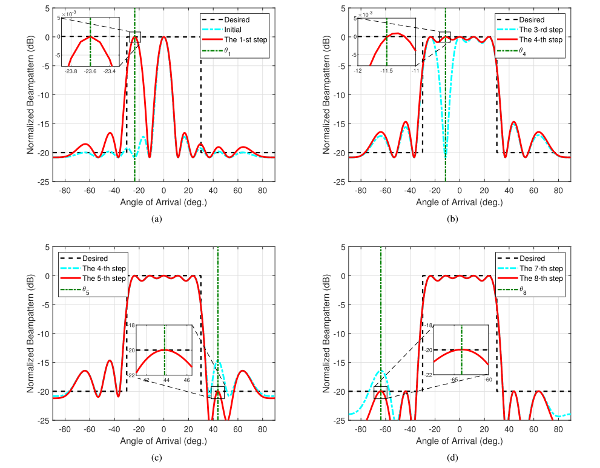
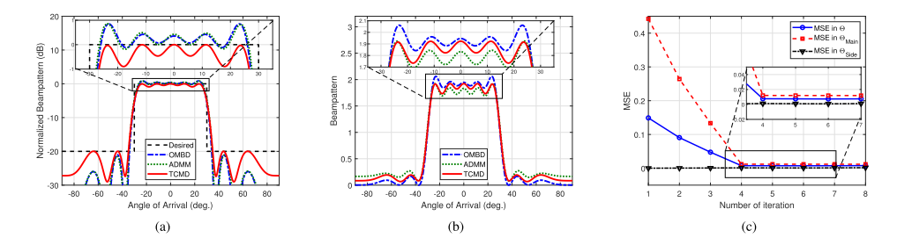
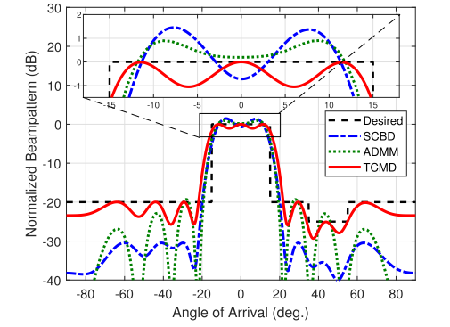
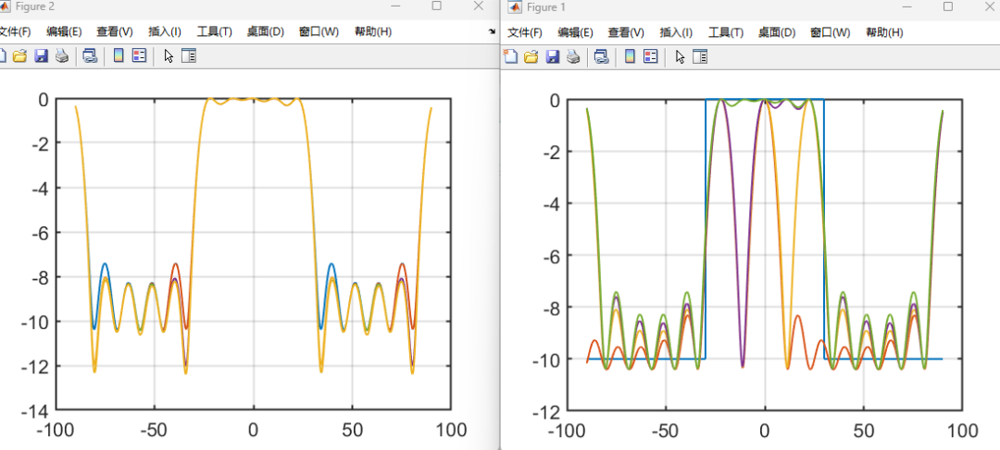

# [Waveform Design]Co-located MIMO Radar Beam Matching Based on Transmit Covariance Matrix [Attached MATLAB Code]

Introduction It is well known that MIMO radars, which employ multiple transmit antennas to emit different waveforms at the same time, offer increased degrees of freedom (DoF) and superior detection performance compared to traditional phased array radars [1-3]. The primary challenge for MIMO radars is the design of the beamforming pattern, which can be achieved through the use of transmit waveform design [4]. In existing literature, transmit waveform design can generally be categorized into two types: direct waveform design [4-8] and covariance matrix (CM) design [9-13], followed by generation of waveforms based on the designed CM. Unlike direct waveform design techniques, waveform design using the CM reduces computational complexity [14]. Therefore, this paper attempts to obtain an approximate desired beamforming pattern through CM design.
The author presents the earliest in-depth investigation of MIMO radar beamforming in [9], formulating a constrained least squares problem to approximate the ideal beam pattern. Additionally, [10] introduces semidefinite programming (SDP) algorithms to enhance the efficiency of CM design. Furthermore, [11] introduces two algorithms for implementing MIMO radar beam pattern matching. Specifically, the Orthogonal Beam Design (OBD) algorithm is proposed to match the desired beam pattern; and the Sequential Beam Design (SBD) algorithm based on minimization criteria for 1-norm, 2-norm, and infinite norm is introduced for comprehensive control of sidelobes in the beam pattern. The primary drawback of these methods is their use of optimization techniques [15], and they are computationally expensive for large antenna arrays. In [16], closed-form algorithms were developed to reduce the computational complexity of CM design. However, these methods are used as approximations to the desired beam patterns. In [17], an approach based on Discrete Fourier Transform (DFT) is proposed to achieve low-complexity beam pattern matching. However, from [6, 14], it can be seen that the performance of the DFT-based method is slightly inferior when the number of antennas is small. To explain the inaccuracies in knowledge representation on the array manifold, [18] discusses the robust design of MIMO radar beam patterns in the context of array manifold inaccuracies. Peak sidelobe level is considered as the quality factor, and polynomial time programs are used to synthesize the required optimal MIMO waveform covariance matrix. Moreover, [19] investigates the robust design of MIMO space-time transmission codes and space-time receiving filters, proposing an iterative method to improve the worst-case signal-to-noise ratio.
For the problem of MIMO radar beam directional pattern design with known array manifold, a Transmit Covariance Matrix Design (TCMD) algorithm is proposed, achieving efficient matching of MIMO radar beam directional patterns. The main contributions of this paper are as follows:
1. A new form of CM design is constructed, which can precisely control spatial power in specific directions with simple control.
2. The closed-form expression for power factor is derived, ensuring that the designed CM is semidefinite and has equal diagonal elements.
3. A new scheme for effectively realizing MIMO radar beam pattern matching is proposed.
Thesis Simulation Results:
Figure. 1. Diagram of the TCMD algorithm on spatial power control, with the desired beam pattern being symmetric with a width of 60 degrees. (a) First step synthesis pattern; (B) Fourth step synthesis pattern; (c) Fifth step synthesis pattern; (d) Eighth step synthesis pattern.
Figure 2. By comparing the synthesized single mainlobe beam patterns, an ideal beam pattern with a 60° symmetry is obtained. (a) Normalized beam patterns of OMBD, ADMM, and TCMD algorithms; (B) Synthetic beam patterns of OMBD, ADMM, and TCMD algorithms; (c) MSE performance of the proposed TCMD algorithm.
Figure 3. Compared with the methods proposed in [11] and [6], our TCMD algorithm requires an asymmetric beam pattern.
Conclusion: A new closed-form algorithm for synthesizing the MIMO radar transmit covariance matrix (CM) is proposed. The designed CM is iterative, and the proposed transmit covariance matrix design (TCMD) algorithm can achieve precise spatial power control. It ensures the semidefiniteness of the designed CM and meets the average power constraint of the CM. Numerical results show that the TCMD algorithm is effective. It can synthesize the required beam pattern with a small number of iterations and its computational complexity is significantly lower than that of optimization-based methods.
MATLAB Code Simulation Results

## Images

<!-- PAYMENT_BLOCK -->

## Get this dataset

- Payment link (Stripe): [Buy now](https://buy.stripe.com/3cs8yP7sY87d0vu9AB)
- Payment QR code: 

<!-- /PAYMENT_BLOCK -->
